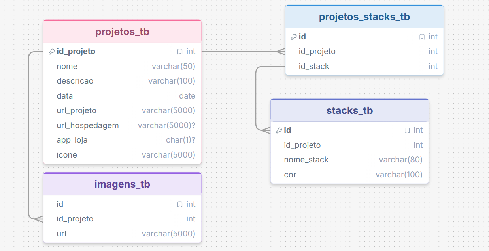
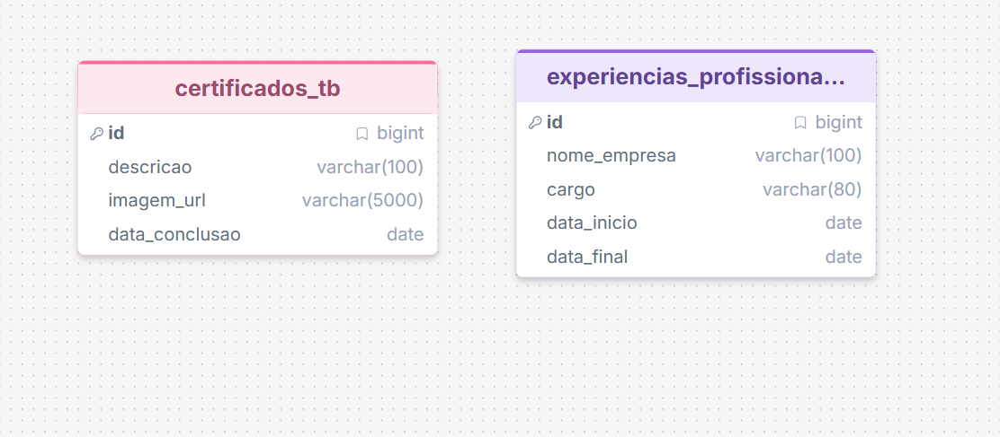

API que retorna dados pro meu portfólio pessoal:
https://cristian-dev-portfolio.vercel.app/

## EndPoints
GET
|
POST
 
<ul>

<li>
<strong>/projetos</strong>
</li>

<li>
<strong>/experiencias</strong>
-> Experiências profissionas.
</li>

<li>
<strong>
/certificados
</strong>
</li>
</ul>

GET

<ul>

<li>
<strong>
/projetos/appsloja
</strong>
-> Informações dos aplicativos na loja.
</li>

<li>
<strong>
/projetos/stacks
</strong>
-> Stacks utilizadas nos projetos.
</li>

</ul>

 

POST
<ul>

<li>
<strong>/projetos/imagens</strong>
</li>
</ul>

 
<strong>Obs</strong>: 
Os métodos POST só podem ser utilizados usando um token interno, caso contrário a API irá retornar com erro.

### Link da api hospedada: 

https://api-portfolio-node-pied.vercel.app/projetos

## Diagrama das tabelas:

